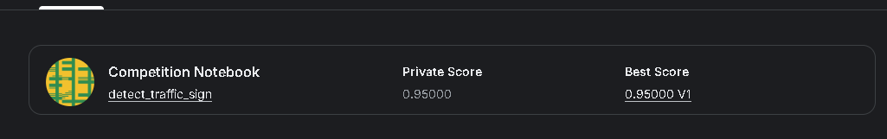

# 澳门路牌识别

一个使用 PyTorch 和 ResNet-50 识别澳门路牌的图像分类项目，共区分 89 类标签。程序根据输入记录裁剪路牌区域，完成图像预处理和模型推理，再生成可提交到 Kaggle 的分类结果。

## 处理流程

1. 读取输入 CSV 和对应图片，按记录中的区域裁剪路牌。
2. 保持图片比例，填充为正方形后调整到 256 × 256，并进行归一化。
3. 将处理后的图片送入单个 ResNet-50 分类模型，预测路牌类别。
4. 根据 `classes.txt` 映射标签，导出表头为 `img,class` 的 `submission.csv`。
5. 输出调试记录，用于检查预测结果和定位问题。

## 实现思路

识别流程以路牌区域为输入，减少背景对分类的干扰。训练初期直接使用整张图片，训练与验证损失表现不理想；检查预处理流程后，改为先裁剪路牌再进行分类训练，随后识别表现改善。

训练和运行分别在家中与学校的环境进行，过程中遇到依赖和路径差异，因此将输入路径、模型配置和推理入口集中整理，便于在不同环境中运行。

## 结果

**Kaggle Private Score：0.95000**，Best Score 同为 0.95000。



## 目录与运行入口

- `src/`：数据处理、训练、评估和推理程序。
- `experiments/`：实验配置与部署辅助程序。
- `classes.txt`：89 类标签。
- `run_kaggle.py`：Kaggle 运行入口，查找 `/kaggle/input` 中的项目、权重和测试数据，再调用推理程序。
- `src/ensemble_infer.py`：当前部署使用的单模型推理入口。

```bash
python -m pip install -r requirements_cpu.txt
python src/ensemble_infer.py --checkpoint checkpoints/final_single_resnet50.pt --input_csv /path/to/test.csv --image_dir /path/to/test --output submission.csv --debug_csv debug_predictions.csv --device cpu
```

仓库不包含模型权重和训练、测试图片。运行前需准备相应数据，并将 `final_single_resnet50.pt` 放入 `checkpoints/`。完整训练日志尚未收录。

开发过程中使用了 AI 辅助生成代码，并通过检查预处理、调整裁剪流程和训练提交来完善项目。
